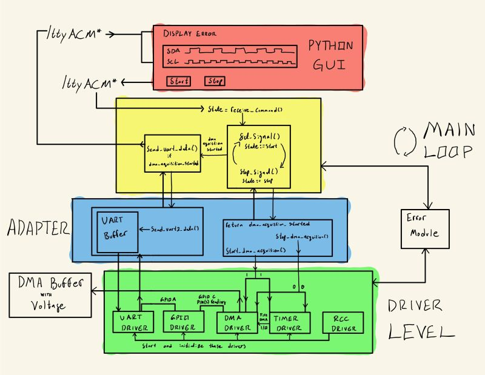
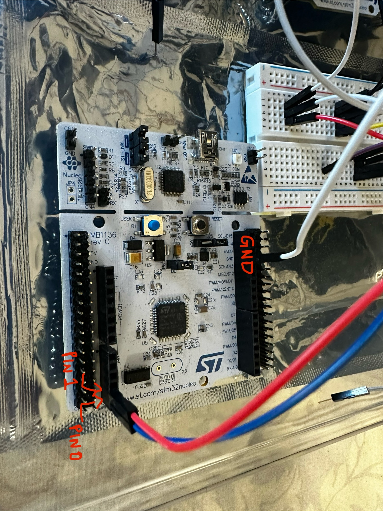

# 2-Pin Logic Analyzer and I2C Protocol Decoder

A bare-metal 2-channel logic analyzer and I2C protocol decoder built from scratch on an STM32F446RE (Cortex-M4) with a real-time Python serial visualizer.

[Logic Analyzer working](https://youtu.be/S_OY3ORduxM)

## System Architecture



* In this project, I showcase my knowledge for seperation of concerns so that the low level is in charge of configuring drivers and providing driver level functions, and the main loop is in change of pure logic. The adapter comes between these two levels to make sure each level is concerned only with their duties and doesn't create functions that doesn't suite their objectives.
* AI was ONLY used to help with the GUI so that the project can be completed at a much faster rate due to time constraints. The seperation of concerns also helped since the GUI only had to be built on top of the usb file(s), which allowed me to inform AI exactly what data to expect and what it means.
* In the diagram, the buffer is shown to be present in the adapter file, however it's created and managed via pointers in the uart driver's file, but since the main loop adds to the buffer, I thought it most appropriate to add it to the adapter layer to showcase it's usage by both the high and low level.


## Key Technical Highlights

* **Run-Length Encoding (RLE):** Added RLE after noticing that some states lasted for multiple reads, reaching a maximum of almost 2 million samples. Instead of sending every state as a byte, a header was sent where bit0 and bit1 was the current state, bit2 - bit6 was the count and bit7 was one to indicate a header byte. Then the next two bytes were basically a continuation of the count where 8th bit was always zero to indicate continuation. If a state's count was longer than the 3 bytes the RLE could handle, it would simply resend the state along with the remaining count. 
* **UART Circular Buffer:** Added a circular buffer for transmitting so rapid back-to-back state changes doesn't cause corrupted or lost bytes during bursts. A producer pointer advances as encoded data gets added to the buffer while a UART2 interrupt shifts bytes out asynchronously while also incrementing it's own consumer pointer in the buffer.
* **Non-Blocking State Transitions:** Ensured that this project unlike the [SGP30-Sensor Project](https://github.com/KAbdullah/Bare-Metal-I2C-Communication-with-SGP30-Sensor) used non-blocking state transitions to complete its tasks and not idly wait until a transaction was completed by using timers. If a task weren't completed then the state wouldn't advance, skipping tasks that relied on the advanced state and completing other tasks that didn't rely on the advanced state and/or the current state for that matter.  
* **DMA Transfer & Timers:** Used DMA to transfer state data from the GPIO pins to the DMA buffer, avoiding using interrupts, so the CPU can handle encoding the data and sending it out via UART2 instead of spending every nanosecond to read pin voltage data. Used a timer (TIM1) to enable a DMA request every 2MHZ.
* **Error Handling:** Due to time constraints, Error handling was only done for DMA transfers (TEIE) as shown [here](https://youtu.be/5pgzcUC6hbQ), because a bad DMA state can corrupt capture memory immediately.

## What you need to get it working

* Work in a Linux system (I did this in Ubuntu 24.04)
* An STM32F446RE board
* 3 jumper cables: two for sniffing voltages and one for grounding it to the target board

## Setup & Usage

1. Install CMake:
   ```bash
   sudo apt install cmake
   ```

2. Clone my GitHub repo locally.

3. Run in the parent directory:
   ```bash
   cmake -S . -B build
   cmake --build build --target flash
   ```

4. In another terminal, run:
   ```bash
   python3 visualizer.py
   ```
   * From the Serial port options, select `ttyACM*` (whichever one shows up for the board running the logic analyzer code).
   * Keep the default baud rate.

5. Click **Start** and see the voltages for two pins get populated on the screen in real time.

   ---

   > **Note:** If you are working in Windows and have VS Code running on a Linux virtual machine, you need to pass the USB traffic from Windows to your virtual machine.
   >
   > I was using WSL 2, so I used the below command in administrative PowerShell:
   > ```powershell
   > usbipd attach --wsl --busid <BUSID>
   > ```
   > *(You can get this number by running `usbipd list`)*

6. The picture below demonstrates how to attached the jumper cables, where PIN 0 and PIN 1 are your voltage sniffers and the GND pin is so your logic analyzer and the target board share the same commond ground.

   


## Future Improvements

- **Expanded Error Handling:** Add additional error handling for Transmit ring buffer overflows, DMA FIFO errors (FEIF), detecting UART overrun errors, etc...
- **User-Configurable Options:** Allow for more user configurable options such as sampling rate selection, # of pins, more protocol decoding.
- **Isolated Logic Testing:** Develop better testing by creating a separate testing module to test higher level logic such as state transitions. (Will try this for my Game Boy project)
- **Architectural Separation & Modularity:** Better architectural separation and modularity so more user configurable options are available along with better testability for high level logic.